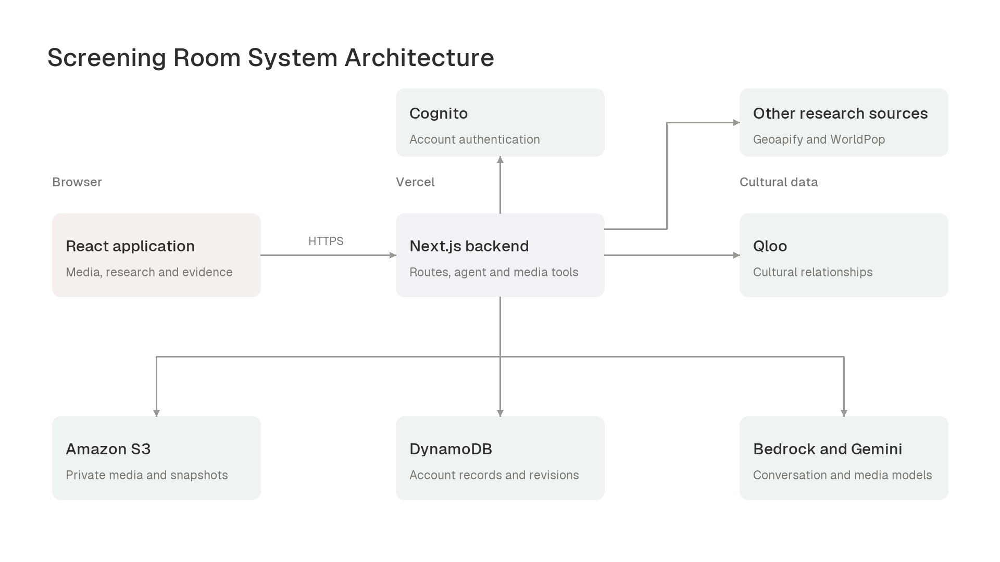
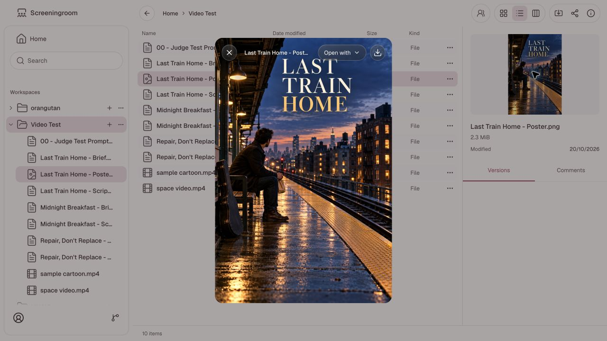
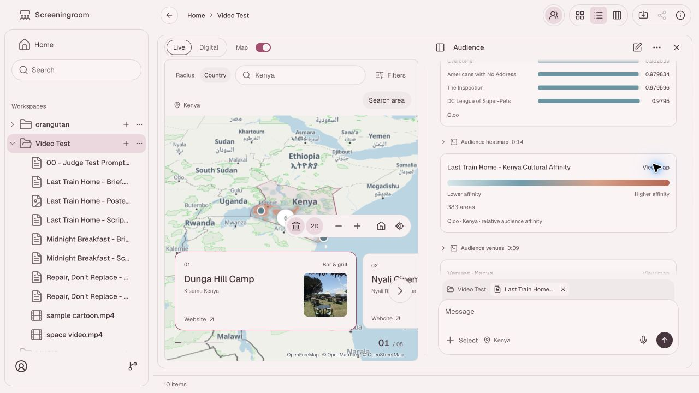
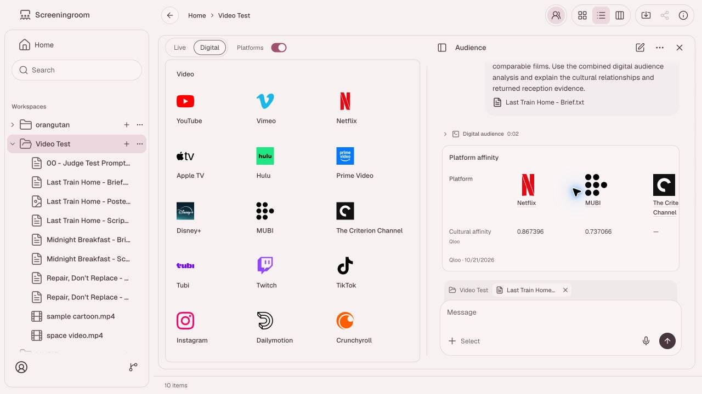
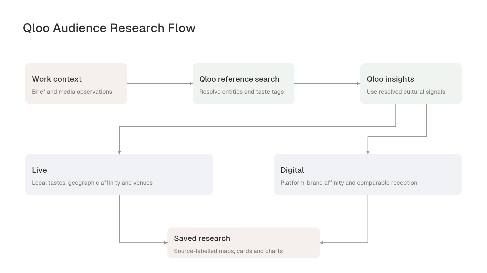

<h1 align="center">Screening Room</h1>

<p align="center">
  
  
  
  
  
</p>

Screening Room is a cultural intelligence workspace for researching audiences for films, music, writing, and other creative work. Users bring project materials or a brief, analyze their content, and use Qloo's cultural relationships to investigate audience interests, geographic areas, venues, and digital platforms. Research evidence stays with the source material and the conversation that produced it.

[Open Screening Room](https://screeningroom.nairobilaboratories.com/)

<table>
  <tr>
    <td><strong>Media understanding</strong><br />Read briefs, inspect images and video, and transcribe recordings to establish what the work contains.</td>
    <td><strong>Qloo audience research</strong><br />Resolve cultural references and taste tags, then investigate affinities and comparable works.</td>
  </tr>
  <tr>
    <td><strong>Live and Digital</strong><br />Explore geographic audiences and physical venues, or research platform-brand affinities and comparable reception.</td>
    <td><strong>Workspace evidence</strong><br />Keep files, conversations, source-labelled widgets, maps, and charts together.</td>
  </tr>
</table>

## System overview

The React interface and Next.js App Router backend form one application. Authenticated route handlers stream an AI SDK tool-loop agent that can inspect selected material, resolve references through Qloo, and return validated research widgets. Qloo supplies cultural relationships; the agent connects those relationships to the user's work and explains the resulting evidence.

Amazon Bedrock provides the conversation model and dedicated image and audio models. Gemini can analyze public YouTube URLs directly when configured. Cognito authenticates accounts, S3 holds private media and workspace snapshots, and DynamoDB stores account records and snapshot revisions. The frontend and route handlers deploy together on Vercel.



## Product workflow

### Bring the work

Import files, folders, or HTTP(S) links into a workspace, then select the materials relevant to a question. Text briefs, subtitles, CSV, and JSON can be read directly. Image, audio, and video tools inspect the selected asset; selecting a folder grants access to its descendants. A sufficiently detailed written brief can also establish the work without an upload.

Files support previews, versions, and comments. Audio and video use inline playback, PDFs use PDF.js, and YouTube links have an embedded player. PDF content analysis currently requires a text export.

The screenshot below shows the actual workspace preview with a generated poster for the fictional project *Last Train Home*.



### Understand the material

Chat supports general questions and analysis of selected work. Uploaded video analysis samples representative frames and includes a transcript when an audio track exists. Images return visible observations and text; audio returns spoken words or audible lyrics with uncertainty. Results retain their source and coverage so a sampled overview can be distinguished from a complete transcript.

Audience first establishes the work's medium, subject, and distinctive characteristics. Its research tools become available after that context is established. Media observations inform the choice of cultural references, while Qloo supplies the affinity evidence for those references.

### Research a live audience

Live mode uses local tastes, geographic affinity, and venue research to investigate in-person presentation. Choose a radius around a location or a country, then ask about the audience or suitable venues. Qloo heatmaps and venue results update the map from structured tool output; venue details can expose the cultural references contributing to a recommendation.

Optional WorldPop calculations add dated modeled resident-population estimates for the selected area. Their jobs are loaded explicitly through a user or agent action. Population estimates, venue counts, and Qloo affinity indices remain separate measurements.



### Research a digital audience

Digital mode investigates comparable works, audience interests, and cultural affinity with platform brands. The agent selects relevant candidates from the platform catalogue and resolves their actual Qloo entities before requesting affinity results. Returned reference contributions help explain a result when the provider supplies them.

Platform affinity measures a cultural relationship to the supplied references. It does not establish catalogue availability, subscriber behavior, publishing eligibility, or expected viewing figures. Missing affinity coverage remains absent, as shown for The Criterion Channel in this example.



## Qloo research architecture

Original media enters the research pipeline through a brief or observed content. The model interprets those observations into candidate comparable works and taste tags; Qloo resolves the references and supplies the relationships used for research. An uploaded film or song is therefore researched through explicit cultural proxies rather than receiving an invented direct Qloo score.



Entity search uses `/search`, taste-tag lookup uses `/v2/tags`, and relationship queries use `/v2/insights`. Depending on the question, tools request local tastes, geographic affinity cells, demographic affinity, venues, or platform brands. Comparison tools also use `/v2/analysis/compare`. Geographic queries carry the selected location context; country research can send polygon filters.

Requests and responses pass through typed tools and Zod schemas. The request context reuses identical Qloo calls, while saved tool evidence lets follow-up questions reuse earlier results. Widgets retain sources, retrieval times, units, and the basis of a measurement. Evidence charts derive their numbers from validated tool results.

Affinity indices are relative signals, not percentages of people who will enjoy the original work. The agent is instructed to compare scores within their query, distinguish interpretation from provider evidence, and surface provider errors and unavailable coverage explicitly.

The main implementation is in [agent composition](app/agents/index.ts), [Audience instructions](app/agents/audience-format.ts), [Qloo transport](app/tools/qloo.ts), and [research tools](app/tools/media-research.ts).

## Media processing and persistence

The AWS configuration script selects `zai.glm-5` for conversation. Media tools default to `google.gemma-4-26b-a4b` for image and video-frame understanding and `google.gemma-4-e2b` for audio transcription. FFmpeg and FFprobe prepare uploaded media on the server. Transcription processes decoded audio in 30-second windows; video inspection combines sampled frame observations with the requested transcript coverage.

Successful media analyses and extracted frames are cached under the owner's S3 prefix using source content, model, and analysis parameters. Changed content or parameters produce a different cache identity. When `GEMINI_API_KEY` is configured, public YouTube analysis uses native Gemini video input; otherwise the configured download path prepares media for the Bedrock tools. Provider failures remain visible.

Cognito sessions use HttpOnly cookies. The server derives ownership from the authenticated account. DynamoDB records use `pk=USER#<subject>` and `sk=<kind>#<UUID>` with optimistic versions; private S3 objects live beneath `users/<subject>/`. Workspace snapshots include conversations, drafts, and tool evidence, with their current revision recorded in DynamoDB. Conflicting writes return an explicit conflict rather than silently replacing another revision.

Media delivery uses signed URLs and an account-scoped browser range cache. Sign-out clears that cache. Mutating API routes validate the request origin, and provider credentials stay server-side.

## Local development

Use Node.js 24 to match the deployment runtime, pnpm, and an AWS account with the services declared in [the CloudFormation template](infra/screeningroom.json). The application needs Cognito, DynamoDB, S3, and a Bedrock Mantle project with access to the selected models. Audience research also requires Qloo API access.

```sh
pnpm install
```

### Configure services

For an existing `screeningroom-dev-foundation` stack, the configuration script reads its outputs and writes an ignored `.env.local` with owner-only permissions. It requires Python 3 and an AWS CLI profile authorized to inspect the stack and manage its dedicated runtime key. Replace the profile name below with your provisioning profile. The script does not create the stack.

```sh
python3 scripts/configure-aws.py --profile your-provisioning-profile
```

The script preserves unrelated settings and refuses to replace an existing runtime key whose secret it cannot recover. For manual configuration, supply these server-only values in `.env.local`:

```dotenv
AWS_ACCESS_KEY_ID=<runtime-access-key>
AWS_SECRET_ACCESS_KEY=<runtime-secret>
AWS_REGION=us-east-1
AWS_DEFAULT_REGION=us-east-1
DYNAMODB_TABLE_NAME=<table-name>
S3_BUCKET_NAME=<private-bucket-name>
COGNITO_USER_POOL_ID=<user-pool-id>
COGNITO_CLIENT_ID=<app-client-id>
BEDROCK_PROJECT_ID=<mantle-project-id>
BEDROCK_MODEL_ID=zai.glm-5
BEDROCK_BASE_URL=https://bedrock-mantle.us-east-1.api.aws/v1
APP_ORIGIN=http://localhost:3000
QLOO_HACKATHON_API_KEY=<qloo-api-key>
QLOO_HACKATHON_API_SERVER_URL=<https-qloo-api-base-url>
```

Qloo settings must be added separately after running the AWS configuration script. Use the HTTPS server URL supplied with your Qloo access. Keep credentials out of `NEXT_PUBLIC_*` variables.

Optional settings:

- `GEMINI_API_KEY` enables native public YouTube analysis; `GEMINI_YOUTUBE_MODEL_ID` overrides its default `gemini-3-flash-preview` model.
- `BEDROCK_VISION_MODEL_ID` and `BEDROCK_AUDIO_MODEL_ID` override the media models.
- `VENUE_DATA_PROVIDER=geoapify` with `GEOAPIFY_API_KEY` selects Geoapify for supported geographic venue searches. Qloo remains the default venue provider and supplies cultural affinity.
- `FFMPEG_PATH` and `FFPROBE_PATH` override the bundled executables.
- `DEMO_ACCOUNT_EMAIL` and `DEMO_ACCOUNT_PASSWORD` configure the intentionally shared demo sign-in action. Use only a dedicated demo account: this action exposes its credentials to fill the sign-in form.

### Run and validate

```sh
pnpm dev
```

Open [localhost:3000](http://localhost:3000) and create or sign into a Cognito account. `APP_ORIGIN` must match the browser's exact scheme, hostname, and port.

```sh
pnpm typecheck
pnpm build
node --experimental-transform-types --conditions=react-server --test tests/qloo-tools.test.mjs tests/digital-audience.test.mjs tests/media-research.test.mjs
```

The build prepares the checksum-verified yt-dlp executable and bundles the platform-specific media binaries. It requires network access when the executable is not already cached. Tests above check local contracts; exercising real providers requires configured credentials and explicit requests through the application.

## Deployment

[vercel.json](vercel.json) deploys Next.js in `iad1`. Configure Node.js 24 and the server-only service variables in the Vercel project before deployment. The chat route uses the Node.js runtime and declares a 300-second function duration; its executable dependencies are traced through [next.config.ts](next.config.ts).

Production can leave `APP_ORIGIN` unset to validate mutations against each request URL's origin across assigned hostnames. The current infrastructure template defines development resources; choose the intended environment's resources and credentials explicitly when deploying another environment.

## License

[MIT](LICENSE)
